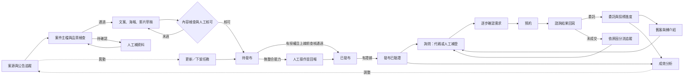

# 104法拍網｜法拍服務團隊　行銷與客戶經營系統：整合交付（2026-11-06）

> 狀態：第一階段完成，第二階段以草稿模式跑通。程式已放上 `ops-foundation` 分支，**尚未合併到 `main`，也未部署。沒有連接任何平台，沒有發布、發訊息或產生廣告支出，正式網站未改動。**

## 1. 現況盤點與缺口

### 讀到了什麼
| 來源 | 位置 | 狀態 |
|---|---|---|
| 網站與每日排程 | GitHub `as29751168/fapai-site` 的 `main`、本機備份 tar | 讀了排程、收費、LINE 名單程式 |
| 營運系統基礎 | 同專案 `ops-foundation` 分支 | 讀了全部 `ops/`、`tests/`，本次沿用 |
| SEO／GEO 後台 | `Documents\seo-admin`（Next.js＋PostgreSQL） | 讀了資料結構與文件，未改動 |
| 法拍工作規則 | `foreclosure-case`、`fapai-daily`、`fapai-listing-poster`、11/4 版提示詞 | 讀了規則 |
| AGENTS.md | 找不到 | 專案未提供 |

**未讀：** `feat/admin-articles`、`preview-new-home`、`site-improve-from-competitors` 三個分支的內容，以及 n8n、Google 試算表（本機未發現設定）。

### 各項功能狀態
| 項目 | 狀態 | 說明 |
|---|---|---|
| 網站、每日同步、開標結果 | 可用 | `main` |
| 案件主檔、去重、異動任務 | 已有程式，未上線 | `ops-foundation`，尚未合併 |
| 素材審閱、發布授權、上線前查核 | **本次新增** | `ops/workflow.py`、`ops/content.py` |
| 追蹤代碼、人工補登來源、一客多案 | **本次新增** | 僅程式，尚未放進實際連結 |
| 逐步問需求、預約、諮詢回寫、未成交分流 | **本次新增** | 分流追蹤天數是建議值，待確認 |
| 委託與投標進度、轉介紹、停止聯絡 | **本次新增** | |
| 收費條件集中管理 | **本次新增** | 衝突項目已標待確認 |
| 平台、案件、活動成效 | **本次新增** | 缺資料顯示未取得 |
| 每日待辦畫面 | **本次新增（唯讀）** | 目前只能產生檔案，不能在畫面上操作 |
| LINE 名單 | 部分 | 正式環境只存 LINE 名稱與登入次數 |
| SEO 後台 | 本機原型 | 全部 DEMO 資料，未連外部服務，未部署 |
| 影片素材、LINE 分眾 | 未開始 | 屬第四階段 |

### 重複或會互相打架的地方
1. **兩套資料庫：** `ops` 用 SQLite／D1，`seo-admin` 用 PostgreSQL。建議案件與客戶以 `ops` 為準，SEO 後台只管內容；兩邊要不要接起來需你決定。
2. **`fapai-daily` 技能**會自動寫入 House-Info，與「未授權不得發布」衝突，建議停用或改寫。
3. **聯絡窗口規則衝突：** 本次需求固定放 Pitt 與 Anna；`foreclosure-work` 的設定是每案只放一位、不放 Pitt。系統先照本次需求。
4. **海報規則衝突：** `fapai-daily` 有換天空的精修做法，`profile.md` 禁止更換天空。系統採不改變建築外觀；既有核定模板待你確認。
5. **收費衝突**見第 7 節。

## 2. 整合流程



模組交接表見 [模組交接表.md](模組交接表.md)，由 `ops/modules.py` 產生。

## 3. 程式與資料結構

沿用 `ops-foundation`，`core.py`、`schema.sql`、`import_package.py` 維持原樣。

| 新增檔案 | 內容 |
|---|---|
| `ops/migrations/002_marketing_crm.sql` | 新增欄位與資料表，不刪改既有資料 |
| `ops/workflow.py` | 素材、刊登、授權、客戶、預約、委託、收費、成效 |
| `ops/content.py` | 文案與海報規格草稿、發布前檢查 |
| `ops/modules.py` | 八個模組的交接定義 |
| `ops/dashboard_html.py` | 唯讀每日待辦畫面 |
| `ops/pilot.py` | 草稿模式試跑 |
| `tests/test_workflow.py` | 32 項驗收測試 |

## 4. 各平台接通狀態

| 平台 | 狀態 | 目前做法與原因 |
|---|---|---|
| 自有網站 | 部分 | 每日同步已有；刊登紀錄先人工回報 |
| 透明房訊、買屋網 | 只讀（本機） | 比對擴充功能可讀取；無確認的官方刊登 API，刊登維持人工回報 |
| House-Info | 只讀（本機） | 同上；需登入後才有的識別碼，刊登維持人工回報 |
| Toro591 | 未接進系統 | 舊流程有用；需確認使用條件與頻率 |
| FB 粉專、影片、Reels | 未接 | 需 Meta 授權 |
| FB 廣告 | 未接 | 需廣告帳號授權與支出授權；系統預設拒絕啟用 |
| 行銷快手、EZUP | 未確認 | **未假設其功能，需你說明** |
| LINE@ | 未接 | LINE Login 有；Messaging API 需金鑰。無法從網站自動取得身分，採代碼加人工補登 |
| FB 社團、其他社群 | 人工 | 未確認有可用的官方發文方式，採草稿加人工回報 |
| GSC、GA4 | 未接 | 需授權；SEO 後台尚未連線 |
| 法院公告 | 人工查核 | 上線前查核的查詢方式待定，目前必須由人或日後的工具提供結果 |

## 5. 測試結果與實際操作

### 2026-11-06 實際執行結果
- 新增驗收測試：**32／32 通過**。
- 既有測試：**16／16 通過**（pytest 未安裝，改用替代執行器，含備份資料匯入）。
- 真實資料經新結構匯入：498 筆新增，再匯入 0 筆新增（498 筆相同）；即將投標 93 件、待補資料 58 件。
- 草稿試跑：虎林街141巷8號3樓走完建檔→素材→刊登任務→測試詢問→客戶→預約→追蹤→成效。

### 需求要求的驗證項目
| 項目 | 結果 |
|---|---|
| 同一案件重複匯入不重複建檔 | 通過 |
| 正式價格與預估價格不混用 | 通過 |
| 停拍或價格變更能找到受影響廣告 | 通過 |
| 發布失敗不被標成完成 | 通過 |
| 任務重試不重複發布或發訊息 | 通過 |
| 客戶詢問可連到案件與來源 | 通過 |
| 預約與下一步可追蹤 | 通過 |
| 未設定授權不產生實際廣告支出 | 通過 |
| 無資料時儀表板不顯示虛構成果 | 通過 |

### 測試沒有涵蓋的
- 試跑案件的資料來自既有紀錄，**未向法院重新查核**，執行機關留空；試跑客戶是虛構的。
- 沒有對任何真實平台發布，也沒有接收真實詢問。
- 系統尚未部署。程式庫目前沒有輸入介面，日常操作要靠後續畫面。
- SEO 後台與本系統尚未整合。

### 操作方式
```bash
python tests/test_workflow.py
python -m ops.pilot output
```
結果在 `output/`：`pilot_dashboard.html`、`pilot_post_draft.txt`、`pilot_log.txt`。

## 6. 部署、備份、回復

- **目前未部署。** 程式在 `ops-foundation` 分支，尚未合併到 `main`，所以不影響正式網站與每日排程。
- **合併前：** 開合併請求檢查，確認 `ops-foundation` 與 `main` 的差異後再決定。
- **專案目前是公開的：** 客戶資料與 `ops.db` 絕不可放進專案（既有 `.gitignore` 已排除 `ops.db`）。金鑰與權杖放平台的環境變數。
- **資料庫上線前：** 先備份；D1 用 `wrangler d1 export`。
- **回復：** 程式回復到前一個提交。資料庫還原備份；新增內容不影響既有網站，`build.py`、`scrape.py` 沒有改動。

## 7. 需要你提供或決定

### 收費（有衝突，已標待確認，系統不會對外使用）
1. 全程代標的計算基準：**標價**（網站）還是**該拍次公告底價**（fees.md）？
2. 600 萬元以下：**最低 12 萬元**（網站）還是**另議**（fees.md）？
3. 尾款代墊用語：「協助代墊」（網站）或「保證代墊」（fees.md）？系統規則是不得保證，建議用前者。
4. 「未得標不收服務費」可否對外使用？適用範圍為何？
5. 優惠期間、貸款條件的現行版本與生效日。

### 決策
6. 行銷快手、EZUP 各負責什麼？
7. 是否合併 `ops-foundation`？資料庫用 D1，還是沿用 SEO 後台的 PostgreSQL？
8. 對外聯絡一律放 Pitt 與 Anna 兩位，還是維持每案一位？
9. 未成交追蹤天數（資金未備妥 90、暫無適合案件 14、仍在了解 30、延後購買 90 天）是否合適？
10. `fapai-daily` 是否停用？
11. 專案是否要改為私有？
12. 真實試跑要用哪一件案件？目前用虎林街141巷8號3樓，需補上執行機關與法院公告查核。

### 帳號授權（需要時才給，金鑰不要貼在對話裡）
13. Meta 粉專與廣告帳號授權，以及**廣告支出授權**（平台、上限、期間、核准人）。
14. LINE 官方帳號 Messaging API。
15. GSC、GA4 權限。
16. 既有核定海報模板檔案與照片使用權限紀錄。

## 8. 下一步

第二階段補：可操作的管理畫面、實際案件查核。
第三階段：接公告異動與提醒，再逐一接平台。
第四階段：FB 影片、LINE 分眾、社群與舊客經營。
