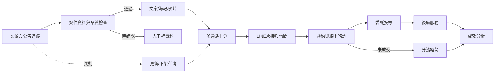

# 104法拍網｜法拍服務團隊　營運系統：盤點與交接

> 範圍僅限法拍。本文件對應分支 `ops-foundation`；程式在 `ops/`，測試在 `tests/`。

## 1. 現況盤點

| 項目 | 狀態 | 說明 |
|---|---|---|
| 自有網站（tomin104.com） | ✅ 可用 | `build.py` 產出靜態頁，Cloudflare Pages；含物件頁、區域頁、法拍小教室、費用／流程頁、sitemap、llms.txt |
| 每日資料同步 | ✅ 可用 | GitHub Actions 11:00、16:30：`scrape.py` 讀 104 列表＋透明房訊公開開標清單校正拍次／日期／底價／狀態 |
| 開標結果 | ✅ 可用 | `scrape_results.py`、`data/results*.json` |
| 人工更正 | ✅ 可用 | `data/overrides.json`（每日同步不會蓋回） |
| LINE 登入收名單 | 🟡 部分 | `functions/api/line-*.js` 只存「LINE 名稱、登入次數、來源頁」到 KV；無案件、需求、跟進 |
| 貼文草稿 | 🟡 部分 | `/post` 頁產出 FB／LINE 文字，需人工複製貼上 |
| 委託留言表單 | 🟡 部分 | `/member` 只把文字複製到剪貼簿再開 LINE，**不會留存、不會建客戶** |
| 案件主檔 | ❌ 原缺 | 只有 `site/data.json`（來源編號為鍵）；無執行機關、無異動歷史、無預估價欄位 |
| 素材／刊登紀錄 | ❌ 原缺 | House-Info、買屋網、FB 刊登沒有任何紀錄，無法知道哪些廣告已過期 |
| 客戶／預約／跟進 | ❌ 原缺 | 無 |
| 任務、成效、儀表板 | ❌ 原缺 | 無 |
| AGENTS.md／README | ❌ 無 | 本次未新增，避免覆蓋你既有的 Claude Code 設定 |

**重複與缺口**
- 案件以 104 編號（HH…）為鍵，換平台就變成另一件；`data/seen.json` 只記價格與拍次。
- **104 資料沒有「執行機關」**（500 筆全空）。已在匯入時留空並依「案號＋物件識別」去重；執行機關需從透明房訊公開清單（`scrape_public` 已有 court 欄）補入。
- 500 筆實測匯入：待拍 291、待確認 173、流標 33、停拍 3；62 筆缺關鍵資料（54 筆無案號）→ 標「待確認」並阻擋自動發布。
- 點交狀態只認筆錄「點交情形→」欄位：點交 242、不點交 81、部分點交 18，**159 筆待確認**（不再用全文關鍵字猜）。

## 2. 整合流程

## 3. 模組交接表

| 模組 | 觸發 | 輸入 | 輸出 | 交給 | 完成條件 | 失敗處理 |
|---|---|---|---|---|---|---|
| 1 案源與公告追蹤 | 每日 11:00／16:30 | toro591、透明房訊、法院公告 | 案件更新（含異動歷史） | 2 | 匯入無錯誤、案件版本更新 | 來源抓取過少→不動資料並通知 |
| 2 資料品質檢查 | 案件新增／異動 | 案件主檔 | `needs_review` 與原因 | 3 或人工 | 案號、拍次、日期、**正式底價**齊全 | 缺資料→待確認，阻擋發布 |
| 3 文案／海報／影片 | 案件通過檢查 | 案件、核定模板 | 素材（草稿→待審→已核可） | 4 | 價格、拍次、點交、免責文字核對過 | 缺照片權限→不得使用 |
| 4 多通路刊登 | 素材已核可＋授權 | 素材 | 刊登紀錄（已發布→**已驗證**） | 5、6 | 有網址／截圖證據才算驗證 | 失敗留「失敗」；暫時性錯誤重試≤3；登入／權限轉人工 |
| 5 FB內容與廣告 | 排程／人工 | 刊登、素材 | 貼文、活動 | 6 | 已授權上限內啟用 | 無授權→拒絕啟用 |
| 6 LINE承接與客戶管理 | 詢問進來 | 事件、案件代碼、來源 | 客戶、詢問、回覆任務 | 7 | 每次互動有下一步＋期限 | 重送事件不重複建立 |
| 7 委託與投標進度 | 預約完成／委託 | 客戶、案件 | 階段更新、後續任務 | 8 | 結果回寫 | 未成交→依原因分流 |
| 8 成效與每日待辦 | 每日 | 全部 | 儀表板 | — | 缺資料顯示「未取得」 | — |

## 4. 資料結構（`ops/schema.sql`）

- **案件主檔** `cases`（唯一 case_id）、`case_alias`（各平台編號→案件）、`case_history`（異動歷史）、`case_media`（照片來源與使用權限）
- **素材與刊登** `assets`、`publications`（狀態：素材完成／待發布／已發布／發布已驗證／失敗／待更新／待下架／已下架）、`campaigns`、`spend_authorizations`、`ad_stats`（標註直接追蹤／人工登記／推估）
- **客戶** `customers`、`contact_points`（管道＋帳號為鍵，**不憑姓名合併**）、`inquiries`、`interactions`、`appointments`
- **任務** `tasks`（`idempotency_key` 唯一，重跑不重複）
- `official_floor_price`（只來自法院公告「拍賣紀錄」）與 `estimated_price`（只能人工設定）分開；平台顯示價另存 `listing_price_raw` 僅供比對。

## 5. 驗收結果（`python3 -m pytest tests`，14 項全過）

| 驗收項 | 結果 |
|---|---|
| 同案件重複匯入不重複建檔；跨平台同案併入同一案 | ✅ |
| 同案號不同物件不誤併 | ✅ |
| 正式價與預估價不混用；查不到公告價時不以售價頂替 | ✅ |
| 停拍／價格拍次變更找出受影響刊登，重跑不重複建任務 | ✅ |
| 發布失敗標「失敗」；重送不重複發布；無證據不能標「已驗證」 | ✅ |
| 任務：暫時性錯誤重試≤3、權限錯誤轉人工、完成後不重跑 | ✅ |
| 詢問連到案件與來源；重送事件不重複；同名不同帳號不合併 | ✅ |
| 互動必有下一步；預約不重複 | ✅ |
| 未授權不能啟用廣告；授權後才進行中 | ✅ |
| 無資料時儀表板顯示「未取得」 | ✅ |
| 500 筆真實資料匯入、再匯入無新增 | ✅ |

**尚未做**：「選一件真實案件跑完整草稿流程」只在測試資料上驗證；尚未接任何外部平台。

## 6. 各平台接通狀態

| 平台 | 狀態 | 原因／下一步 |
|---|---|---|
| 自有網站 | ✅ 已接（讀） | 資料流已有；尚未寫回刊登紀錄 |
| 執行機關資料 | ❌ 未接 | 需把 `scrape_public` 的 court 欄對進案件主檔 |
| House-Info | ❌ 未接 | 目前人工後台操作；先做「刊登任務＋人工回報完成」 |
| 買屋網 | ❌ 未接 | 未確認有無 API／匯入功能 |
| FB 粉專／廣告 | ❌ 未接 | 需 Meta 權杖與廣告帳號授權；**行銷快手、EZUP 實際負責的功能尚未確認** |
| LINE@ | ❌ 未接 | 現有 LINE Login（Cloudflare KV）可用；官方帳號 Messaging API 需金鑰 |
| FB 社團 | ❌ 未接 | 無官方發文 API，採草稿＋人工回報 |
| SEO／GEO | ✅ 部分 | sitemap、llms.txt、結構化資料已有；後台管理系統（V2.0 規格）未在此程式庫 |

## 7. 部署、備份、回復

- 目前只是新增 `ops/`、`tests/`、`docs/`，**不影響**網站建置與每日排程（`build.py`、`scrape.py` 未修改）。
- 本機試跑：`python3 ops/core.py import`（建立 `ops/ops.db`）→ `python3 ops/core.py dashboard`。`ops.db` 已列入 `.gitignore`。
- 正式資料庫建議用 Cloudflare D1（`schema.sql` 為 SQLite 語法，可直接用）；需你建立資料庫並授權。
- 備份：D1 匯出 `wrangler d1 export`；上線前先備份。回復：刪除分支或 `git revert`；資料庫採「只增不刪」，重建即可由 `site/data.json` 重新匯入。

## 8. 需要你提供／決定

1. 是否合併分支 `ops-foundation` 到主線，以及是否建立 Cloudflare D1。
2. **行銷快手、EZUP** 各自負責哪些功能。
3. 買屋網、House-Info 是否有匯入／API，或只能人工操作。
4. Meta（FB）與 LINE 官方帳號的 API 授權，以及**廣告支出授權**（平台、上限、期間、誰核准）。
5. 服務費、優惠期間、代墊款、貸款條件的現行版本（`services.py` 的費用與頁面文字有無衝突，請你確認；我沒有自行更動）。
6. 真實試跑要用哪一件案件。
